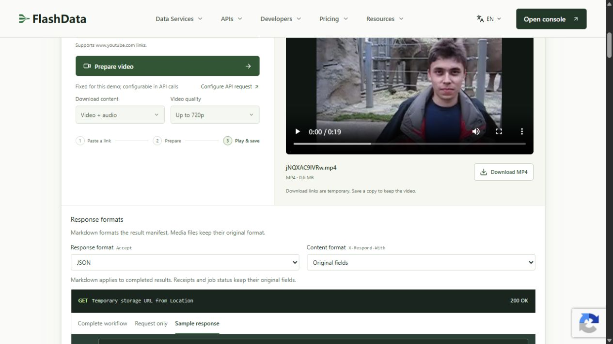
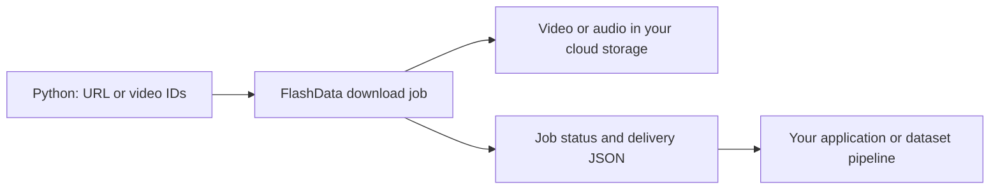

# YouTube Video Download API Toolkit

[](https://github.com/flashdatadev/youtube-video-download-api/actions/workflows/ci.yml)
[](https://www.python.org/)
[](LICENSE)

**Download YouTube videos, extract MP3 audio, create clips and deliver media to your cloud storage with Python.**

Runnable examples for the [FlashData YouTube Video Download API](https://flashdata.dev/products/youtube-download?utm_source=github&utm_medium=readme&utm_campaign=youtube-video-download-api), built on the [official FlashData Python SDK](https://github.com/flashdatadev/flashdata-python). Submit a URL or video ID, save the job ID, and retrieve the delivery result. For larger collections, submit a file of video IDs and export per-video results as JSONL.

FlashData handles YouTube bot challenges, proxy routing, retries and media delivery. Your Python application does not need a local downloader, FFmpeg installation or proxy pool.

[Quickstart](#quickstart) · [Live demo](#real-download-demo) · [Python examples](#runnable-python-examples) · [MP3 audio](#youtube-to-mp3-api) · [Bulk downloads](#bulk-youtube-video-downloads) · [Storage](docs/storage.md) · [Recovery](docs/recovery.md) · [API reference](https://flashdata.dev/docs/sources/youtube_download)

## What you can build

| Task | Included support |
| --- | --- |
| Download a YouTube video | MP4, WebM or MKV; quality selection; video with audio or video only |
| Extract audio | MP3, M4A or Opus; audio-quality options |
| Download a clip | Start/end timestamps in `HH:MM:SS` |
| Collect media for a video dataset | Bulk ID files, metadata companions and per-video delivery records |
| Deliver directly to a bucket | S3, Cloudflare R2/S3-compatible storage, GCS, Azure, OSS, COS, BOS and TOS |
| Continue after your Python process stops | Saved job IDs; result collection without another submission |
| Inspect video formats | A runnable metadata/formats example |
| Explore without credentials | An offline demo with synthetic JSON and JSONL output |

## Quickstart

Requires **Python 3.10+**. Install the official SDK; this first example needs no repository checkout:

```bash
python -m pip install "flashdata>=1.2.0,<2"
```

### Download a YouTube video in Python

[Get a FlashData API key](https://flashdata.dev/signup?utm_source=github&utm_medium=readme&utm_campaign=youtube-video-download-api), then pass it directly in Python. Replace the placeholder key, video ID and bucket credentials. Save as `download.py` and run `python download.py`:

```python
from flashdata import FlashData

storage = {
    "storage_type": "s3",
    "storage_url": "your-media-bucket",
    "region": "us-east-1",
    "access_key": "your-storage-access-key",
    "secret_key": "your-storage-secret-key",
}

with FlashData(api_key="your-flashdata-api-key") as client:
    with open("download-job-id.txt", "x", encoding="utf-8") as saved_job:
        job = client.youtube.download(
            "YOUR_VIDEO_ID",  # The 11-character ID, e.g. jNQXAC9IVRw
            storage=storage,
            output_format="mp4",
            video_quality="<=720",
        )
        print("Saved job:", job["id"], flush=True)
        saved_job.write(job["id"])
    client.jobs.wait(job["id"], timeout=600)
    delivery = client.jobs.result(job["id"])

media = delivery["results"][0]
print(media["file_url"])
print(media["file_size"], "bytes")
```

The **media file is in your bucket**. The printed delivery result identifies its location and size. Use your storage provider to read the object; a private bucket URL does not become public when a download completes. See [storage setup](docs/storage.md) for Cloudflare R2, GCS and other destinations.

The job ID is saved before waiting. If the script stops or `download-job-id.txt` already exists, [recover that job](#recover-an-existing-download) instead of submitting again. Use a different filename for each intentional new download.

## Real download demo

[Try a real download in your browser](https://flashdata.dev/products/youtube-download#playground) — paste a YouTube URL, select **Prepare video**, then **Download MP4**.



Captured on **November 13, 2026** after downloading `jNQXAC9IVRw.mp4`: **635,505 bytes · 320×240 · 19.064 seconds**. The screenshot shows the completed live browser workflow. [View the capture details, checksum and reproduction steps](docs/live-demo.md).

The browser demo delivers a file to your browser. Python API downloads use the cloud storage configured in the quickstart.

## Runnable Python examples

For URL normalization, saved checkpoints, bulk exports and local S3/R2 retrieval, install this repository:

```bash
git clone https://github.com/flashdatadev/youtube-video-download-api.git
cd youtube-video-download-api
python -m venv .venv
```

Activate with `source .venv/bin/activate` on macOS/Linux or `.\.venv\Scripts\Activate.ps1` in Windows PowerShell, then install:

```bash
python -m pip install -e .
```

Copy [examples/config.example.py](examples/config.example.py) to `examples/config.py` and fill in `API_KEY` and `STORAGE` **in that Python file**. The private copy is gitignored. All commands below run from the repository root; replace `YOUR_VIDEO_ID` with your video ID or URL.

| Example | Command |
| --- | --- |
| MP4 with companion metadata | `python -m examples.download_video YOUR_VIDEO_ID --metadata` |
| Select 1080p when available | `python -m examples.download_video YOUR_VIDEO_ID --quality "==1080" --output-dir output/1080p` |
| WebM output | `python -m examples.download_video YOUR_VIDEO_ID --format webm --output-dir output/webm` |
| MP3 audio | `python -m examples.download_audio YOUR_VIDEO_ID` |
| M4A audio | `python -m examples.download_audio YOUR_VIDEO_ID --format m4a --output-dir output/m4a` |
| A 30-second clip | `python -m examples.download_clip YOUR_VIDEO_ID --start 00:00:10 --end 00:00:40` |
| Video metadata and formats | `python -m examples.video_info YOUR_VIDEO_ID` |
| Bulk MP4 delivery | `python -m examples.bulk_download video-ids.txt` |
| Bulk MP3 delivery | `python -m examples.bulk_download video-ids.txt --audio --output-dir output/bulk-audio` |
| Recover a single job | `python -m examples.recover output/video/download.job.json --output output/recovered.json` |
| Recover a running/completed bulk job | `python -m examples.recover output/bulk/download.job.json --bulk --output output/recovered.jsonl` |

Use `--help` on any example. Live submissions use your FlashData account and configured storage. The offline demo is the credential-free path in this repository.

### Explore synthetic output offline

```bash
python -m flashdata_download demo
# Equivalent installed command: flashdata-download demo
```

This writes `delivery.json`, `downloads.jsonl` and `README.txt` under `output/demo/`. These are **synthetic fixtures** for exploring the output without credentials, network requests or credit usage. Use the [live demo above](#real-download-demo) to download a real video.

## YouTube to MP3 API

After installing the runnable examples, use your Python configuration to download MP3 audio:

```bash
python -m examples.download_audio YOUR_VIDEO_ID
```

The [Python example](examples/download_audio.py) sets `download_type="audio"`, `output_format="mp3"` and `audio_quality="192"`, saves the job ID and collects its delivery result. Use `--format m4a` or `--format opus` for other audio outputs. Omit video-quality and frame-rate settings for audio-only work.

## Video quality, formats and clips

| Parameter | Examples |
| --- | --- |
| `download_type` | `audio_video`, `video`, `audio` |
| `output_format` | Video: `mp4`, `webm`, `mkv`; audio: `mp3`, `m4a`, `opus` |
| `video_quality` | `<=720`, `==1080`, `<=2160`, `best`, `worst` |
| `fps` | `<=30`, `==60` |
| `audio_quality` | `best`, `320`, `256`, `192`, `128` |
| `audio_language` | `default`, `original` |
| `start_at`, `end_at` | `00:00:10`, `00:00:40` |
| `upload_metadata` | `True` to deliver a companion JSON file |

Choose an exact resolution only when the source has that format. For a ceiling, use `<=1080` rather than `==1080`. Run the metadata example to inspect formats. See the [complete parameter guide](docs/parameters.md) for combinations and advanced selectors.

## Bulk YouTube video downloads

Create `video-ids.txt` with one 11-character video ID per line, without a header. [sample-data/video-ids.txt](sample-data/video-ids.txt) shows the format; replace those IDs with your own collection.

```python
from flashdata import FlashData
from flashdata_download import collect_bulk, submit_bulk

# Use the storage dictionary from the quickstart.
with FlashData(api_key="your-flashdata-api-key") as client:
    bulk_id = submit_bulk(
        client,
        "video-ids.txt",
        storage=storage,
        checkpoint="output/bulk.job.json",
        download_type="audio_video",
        output_format="mp4",
        video_quality="<=720",
        upload_metadata=True,
    )
    print("Saved bulk job:", bulk_id, flush=True)
    summary = collect_bulk(
        client,
        "output/bulk.job.json",
        output="output/downloads.jsonl",
        timeout=3600,
    )

print(summary)
```

The helper saves the accepted ID **before uploading and starting** the job. A bulk run applies the same media settings to the file. Successful deliveries and failed items are both exported, so you can inspect the collection before deciding which items to retry. The runnable bulk example exits with code `2` when rows fail or input items are invalid.

For a complete collection workflow with ID deduplication, progress tracking, delivery CSVs and a failed-only retry file, use [Bulk Video Download with Python](https://github.com/flashdatadev/bulk-video-download). It builds on the same FlashData SDK and keeps each collection's input, saved job and result inventory together.

For different settings per video, use [batch requests](docs/http-api.md#batch-downloads). For a managed collection, [request a YouTube video dataset sample](https://flashdata.dev/products/youtube-video-datasets?utm_source=github&utm_medium=readme&utm_campaign=youtube-video-download-api).

## Recover an existing download

A local polling timeout leaves the remote job running. For the SDK quickstart, read the original saved ID and continue waiting:

```python
from pathlib import Path
from flashdata import FlashData

job_id = Path("download-job-id.txt").read_text(encoding="utf-8").strip()
if not job_id:
    raise ValueError("No job ID was received. Reconcile the submission before retrying.")
with FlashData(api_key="your-flashdata-api-key") as client:
    client.jobs.wait(job_id, timeout=1200)
    delivery = client.jobs.result(job_id)

print(delivery["results"][0]["file_url"])
```

The runnable examples use JSON checkpoints instead of the quickstart's text file. Recover those with `python -m examples.recover CHECKPOINT --output NEW_RESULT_FILE`, adding `--bulk` for a bulk job. Checkpoints contain job IDs and local workflow information, not API keys or storage credentials. Existing checkpoint and result files are protected from accidental overwrites. See [recovery](docs/recovery.md) for upload drafts, paused bulk jobs, partial exports and expired results.

## How delivery works



Individual API requests run asynchronously. Batch requests return an ID for each accepted query. Bulk jobs accept an uploaded ID file. The service handles media retrieval and cloud upload; this toolkit handles local checkpoints and result exports. See [HTTP requests, responses and webhooks](docs/http-api.md).

## Pricing and access

The published pay-as-you-go download rate is **$0.10 per GB delivered ($100 per TB)**. You can discuss custom PAYG unit rates based on volume or choose a subscription with different rates. See [current download pricing](https://flashdata.dev/pricing/youtube-download) and [volume pricing](https://flashdata.dev/contact).

Download charges follow delivered media bytes. Optional companion metadata files are excluded from download-volume charges. The Python code is MIT-licensed; API usage and your storage provider's charges are separate.

## Frequently asked questions

### Does Google's YouTube Data API download videos?

Google's YouTube Data API covers resources such as video metadata, channels and playlists. FlashData's separate download API retrieves media and delivers it to your storage. This toolkit uses a **FlashData API key**, not a Google Cloud API key.

### Do I need to run yt-dlp, FFmpeg or a proxy server?

No local extractor or proxy configuration is needed for these examples. FlashData manages retrieval, bot handling and delivery. The optional `yt_dlp_format` parameter is an advanced format selector, not a local installation requirement.

### Can I download Shorts, audio or only part of a video?

Yes. The input helper accepts Shorts, watch, live, embed and `youtu.be` links. Choose `download_type="audio"` for audio or `start_at`/`end_at` for a clip. A live URL is normalized to its video ID; this is a download workflow, not a live-stream recording service.

### Is `file_url` a public download link?

It identifies the delivered object in **your storage**. Access follows your bucket's permissions. Read it with the provider's SDK or generate your own signed link. FlashData's API result JSON and your media file are separate objects.

### Can I download a channel or playlist URL directly?

These download helpers accept individual videos and files of video IDs. Resolve a channel or playlist into IDs first; the [YouTube Data API Toolkit](https://github.com/flashdatadev/youtube-data-api) includes discovery and playlist examples.

### Can I use an environment variable instead?

Yes. Direct Python configuration is the primary approach above. In a deployment, the official SDK also accepts `FlashData()` with `FLASHDATA_API_KEY` set by your environment or secret manager.

## Development

```bash
python -m pip install -e ".[dev]"
python -m pytest
python -m ruff check .
python -m ruff format --check .
python -m build
python -m twine check dist/*
```

Tests use mocked HTTP and synthetic fixtures. CI runs on Linux and Windows with Python 3.10, 3.12 and 3.14, without API keys or paid downloads.

[Contributing](CONTRIBUTING.md) · [Security](SECURITY.md) · [MIT license](LICENSE) · [Support](https://flashdata.dev/contact)

Related projects: [Python SDK](https://github.com/flashdatadev/flashdata-python) · [YouTube Data API](https://github.com/flashdatadev/youtube-data-api) · [YouTube Transcript API](https://github.com/flashdatadev/youtube-transcript-api) · [MCP](https://github.com/flashdatadev/flashdata-mcp) · [CLI](https://github.com/flashdatadev/flashdata-cli).
