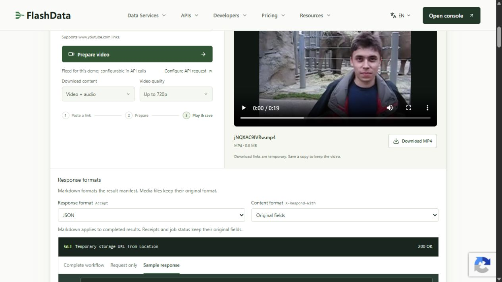

# A real YouTube video download

On November 13, 2026, we ran FlashData's live browser demo with
[`jNQXAC9IVRw` — Me at the zoo](https://www.youtube.com/watch?v=jNQXAC9IVRw),
waited for **Ready to download**, and saved the MP4 using **Download MP4**.

## Captured file facts

| Field | Observed value |
| --- | --- |
| File | `jNQXAC9IVRw.mp4` |
| Format | MP4, video and audio |
| File size | 635,505 bytes |
| Video dimensions | 320 × 240 |
| Duration reported by the browser | 19.063583 seconds |
| Saved at | November 13, 2026, 08:30:44 UTC |
| SHA-256 of the saved file | `3fae44f68f44c70a15eecddc8d93fe828ce820e2867a3328feed42601262fa69` |

The screenshot is an unaltered capture of the completed live demo. The file size
and SHA-256 were read from the downloaded MP4; dimensions and duration came from
the browser's loaded video element. [Machine-readable capture facts](../sample-data/live-download-demo.json)
describe this observation, rather than an API response fixture.

## Try it yourself

1. Open the [YouTube Download playground](https://flashdata.dev/products/youtube-download#playground).
2. Paste `https://www.youtube.com/watch?v=jNQXAC9IVRw`.
3. Select **Prepare video** and wait for **Ready to download**.
4. Play the preview or select **Download MP4** to save the file.

The browser demo uses its video-and-audio MP4 preset with quality up to 720p.
This source delivered at 320 × 240. The API lets you choose formats, quality,
clips and a cloud storage destination through the [Python quickstart](../README.md#quickstart).

Only the screenshot and capture facts are included in this repository. The MP4
and temporary download URL are not bundled. The [offline demo](../README.md#explore-synthetic-output-offline)
is a separate command that creates synthetic fixtures.
